<strong>Português</strong> | <a href="README.en.md">English</a>

Estudante de programação na <strong>Germinare Tech — Instituto J&amp;F</strong> Estagiário no PicPay · Análise de Dados e Planejamento Estratégico — Seguros Interesse profissional em <strong>Engenharia de Inteligência Artificial</strong>

## Sobre mim

Sou Pedro Yada, estudante do segundo ano do ensino médio técnico em programação na Germinare Tech e estagiário no PicPay, onde atuo com análise de dados na área de Planejamento Estratégico da unidade de Seguros.

Meu foco de desenvolvimento é a criação de **sistemas com inteligência artificial e APIs backend**, conectando agentes, ferramentas e bancos de dados para resolver problemas práticos.

Tenho experiência na criação de sistemas multiagentes com **LangChain e LangGraph**, incluindo tools, guardrails, agente juiz, FAQ e RAG. Também trabalhei com **Qdrant** para busca semântica, **MongoDB** para memória e sessões de conversa e **PostgreSQL** em integrações com agentes.

Quero seguir na área de Engenharia de Inteligência Artificial, aprofundando meus conhecimentos em desenvolvimento, infraestrutura e avaliação de sistemas de IA.

Também tenho interesse em explorar **cybersecurity** como uma nova área de estudo.

## Tecnologias

### Inteligência artificial e dados

### Backend e ferramentas

### Infraestrutura e cloud

## Projeto em desenvolvimento

### 🌱 OLIUS — Óleo Amigo

Plataforma web e mobile que conecta cidadãos, estabelecimentos comerciais, pontos de entrega e responsáveis pela coleta para facilitar o descarte correto do óleo de cozinha usado.

O projeto prevê localização de pontos de entrega, solicitação e acompanhamento de coletas, gamificação, indicadores e certificados ambientais.

| Contexto | Minha participação | Status |
| :--- | :--- | :--- |
| Projeto interdisciplinar em equipe, na Germinare Tech | Banco de dados PostgreSQL e API com Spring Boot | Em desenvolvimento |

> A demonstração da plataforma será adicionada quando estiver disponível.

## GitHub Analytics

  

Atualização diária. Contagens conforme as contribuições reconhecidas pelo GitHub e visíveis à consulta.

---

Este perfil reúne meus projetos, estudos e evolução em desenvolvimento de software.

<!--
**yada071/yada071** is a ✨ _special_ ✨ repository because its `README.md` (this file) appears on your GitHub profile.

Here are some ideas to get you started:

- 🔭 I’m currently working on ...
- 🌱 I’m currently learning ...
- 👯 I’m looking to collaborate on ...
- 🤔 I’m looking for help with ...
- 💬 Ask me about ...
- 📫 How to reach me: ...
- 😄 Pronouns: ...
- ⚡ Fun fact: ...
-->
